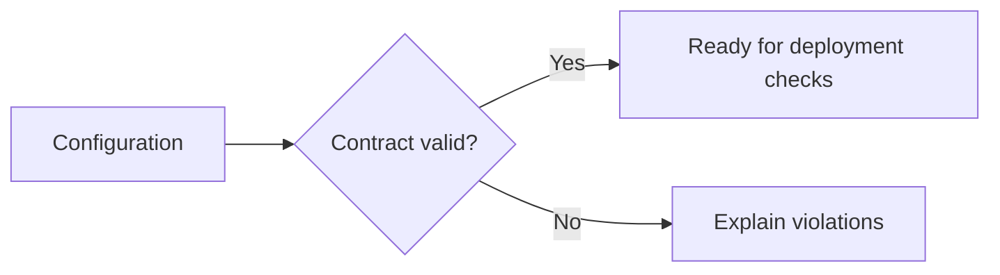
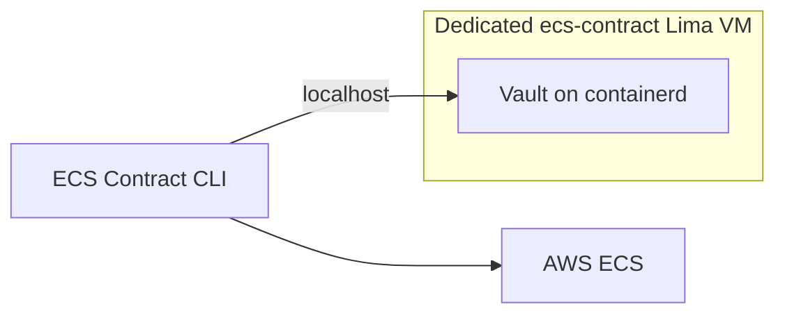

# Show the ownership contract

## Local demonstration

```sh
uv sync --locked
uv run ecsc check --parameters examples/orderbook/parameters.json --secrets examples/orderbook/secrets.json
```

The valid example passes without AWS credentials. Change a required field in a
copy of the example and repeat the check: it must refuse the configuration and
name the violation, without printing secret values. Keep the original fixture.



## Real AWS demonstration

The local checker does not establish a successful deployment. The
[smoke driver](https://github.com/tanya-ok/ecs-contract/blob/main/scripts/smoke.py)
needs an explicitly selected personal AWS profile and region. It creates temporary
resources, exercises the deployment workflow and verifies cleanup. Read
[permissions](permissions.md) and [deployment serialization](serialization.md) first.

### Live run on 2026-10-13

Revision `0c7d111`, personal AWS account, `eu-west-1`, run `ecsc-smoke-89c680`,
06:29 to 06:34 UTC. Result: 60 of 60 checks passed.

| Stage | Observed |
|---|---|
| Contract | `check` passed; `drift` reported six differences against revision 1 |
| Sync | Dry run wrote nothing; sync added the Vault value; a second sync wrote nothing; an unknown key was kept, and named by a prune dry run |
| Render and guard | Only environment, secrets and image changed; tags kept; guard accepted the expected live revision |
| Deploy | Fargate service became stable with one task on revision 2; the container saw all six contract variables |
| Negative cases | Foreign revision 3 detected by `drift` and refused by `guard`; a token in plain environment refused; a missing config secret refused without printing its name |
| Secrets | No generated value appeared in any `ecsc` output, rendered file or container log |
| Cleanup | Service, secrets, parameters, role, policy and log group deleted. The cluster was INACTIVE and the three task definitions were DELETE_IN_PROGRESS, checked separately with the AWS CLI. The local Vault container was removed and the VM stopped |

## Standalone local Vault on containerd

ECS Contract is an independent project. Its local smoke uses a dedicated Lima VM
named `ecs-contract`, with containerd and nerdctl. It does not require Kubernetes,
sibling repositories or the shared security lab. No Docker/Podman daemon is needed.

```sh
uv sync --locked
uv run --no-sync python scripts/local_vault.py up
uv run --no-sync python scripts/demo_vault.py
uv run --no-sync python scripts/local_vault.py stop
```

The pinned VM has 2 CPUs, 2 GiB memory and an 8 GiB sparse disk. It mounts no host
repositories, home directories or credentials. Only Vault port 18200 is forwarded
to host loopback. The pinned OCI Vault container receives a generated token on
stdin, runs without added capabilities and is removed by its exact run name and
ownership labels. Stopping the VM refuses retained containers.



The local Vault demonstration creates no AWS resources. For the complete smoke,
select a personal profile and run:

```sh
AWS_PROFILE=default uv run --no-sync python scripts/smoke.py
```

The driver uses `eu-west-1`. Default teardown removes its AWS resources and owned
local Vault container. `--keep` retains demo resources by explicit operator choice.
Stop the standalone VM separately when no longer needed. Never run the AWS smoke
against a shared or organization account.

The earlier shared-namespace Vault demonstration on 2026-10-13 is historical
runtime evidence. It was superseded by the standalone configuration at the
maintainer's request and does not prove the independent runtime.

Verified on 2026-10-13: the standalone VM started, the actual pinned Vault
container passed synthetic write/read, its owned container was removed and the
standalone VM stopped. The shared security lab remained running. All 168 tests,
lint, formatting, strict types and the documentation build passed.
