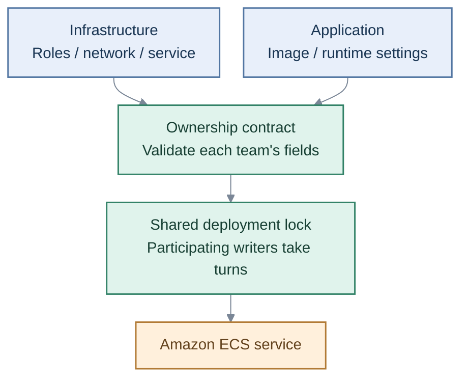

Cloud delivery / Ownership

# Deploy without undoing each other's changes.

Infrastructure and application teams share one ECS service. An explicit ownership contract keeps their deployments from overwriting each other's configuration.

## How it works

[Check locally](demo.md){ .overview-link }
[Ownership and migration](migration.md){ .overview-link }
[Deployment locking](serialization.md){ .overview-link }

!!! note "Scope"
    Local checks are verified. A real AWS deployment still requires a selected personal account and region. Every writer must use the lock.
